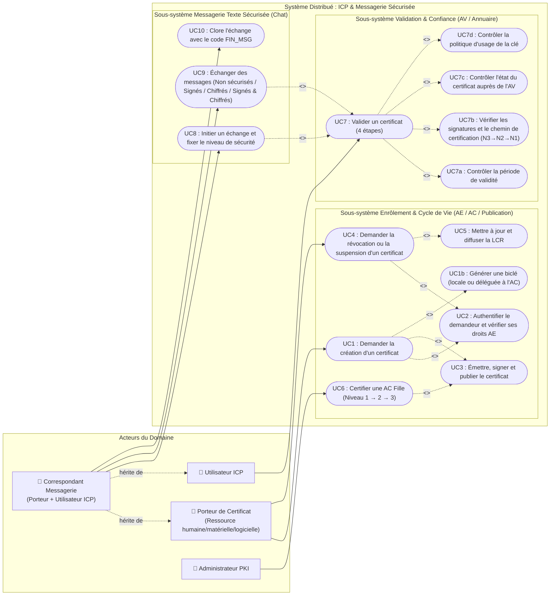
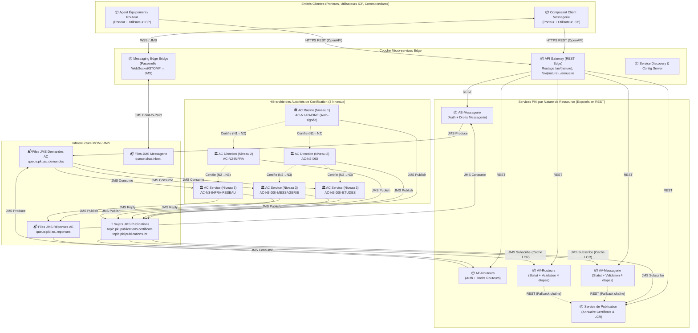
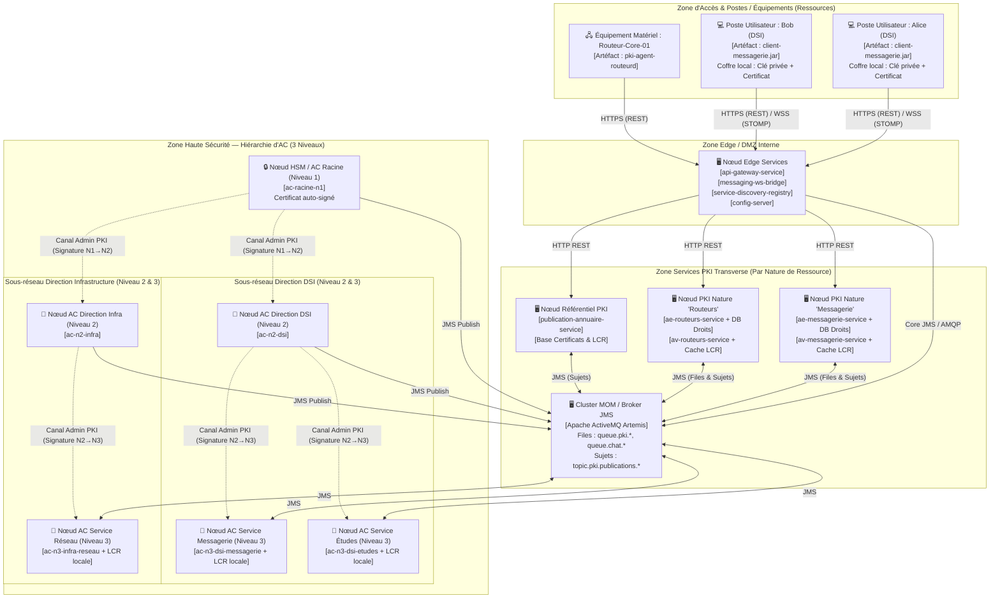
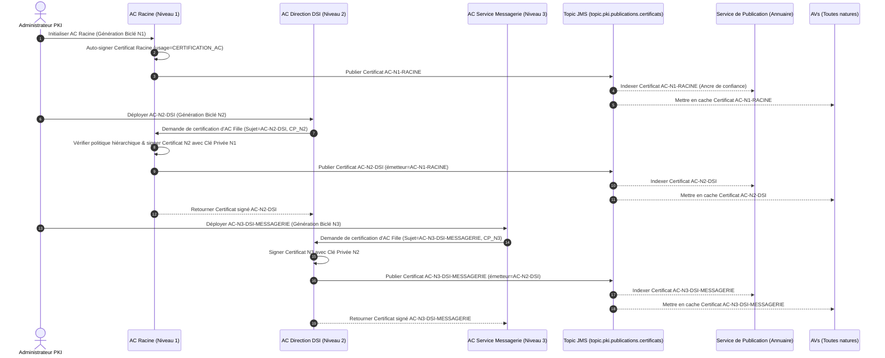
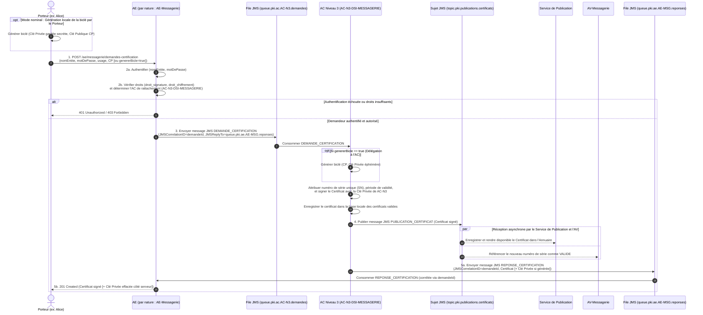
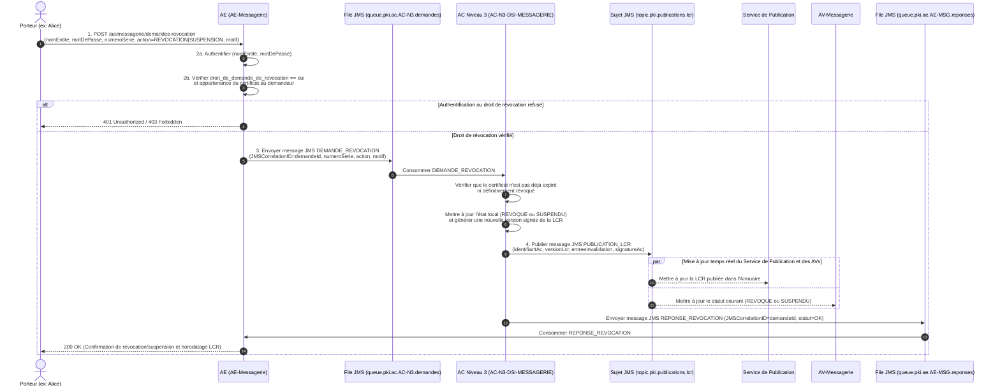
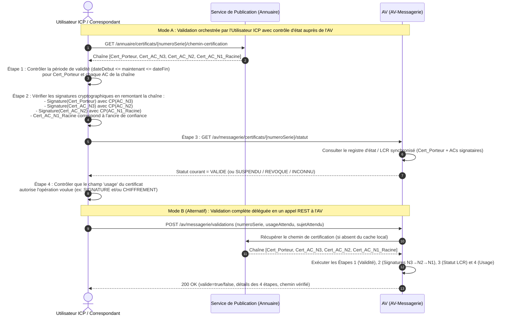
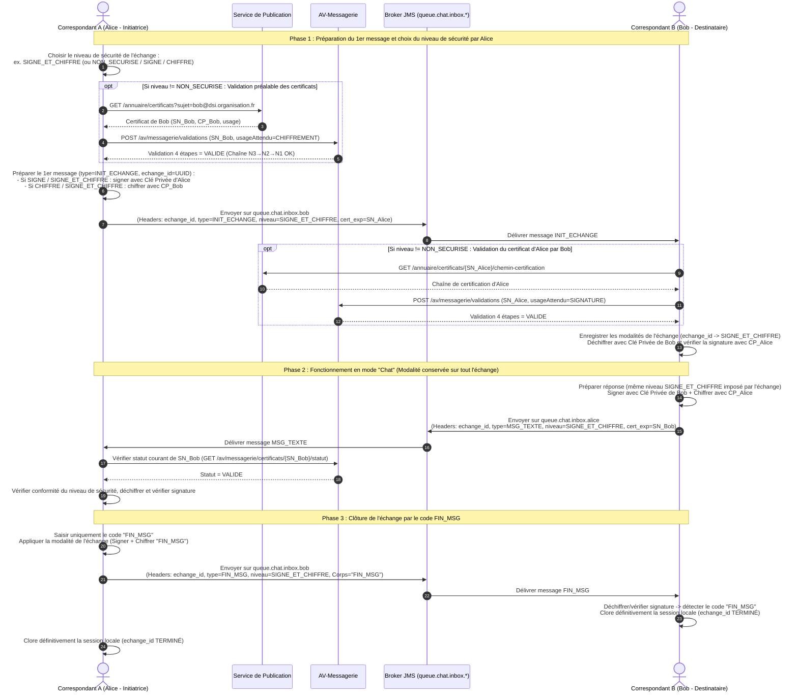
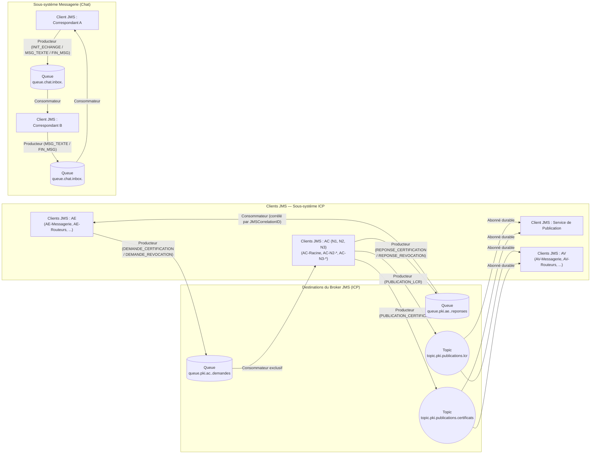
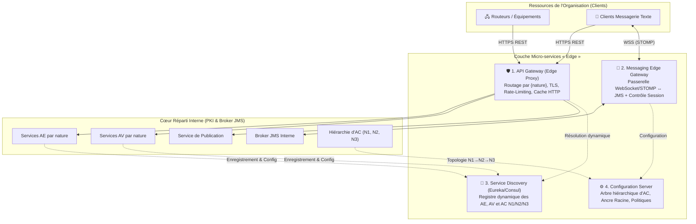

# Dossier de Conception — Infrastructure à Clés Publiques (ICP) & Messagerie Sécurisée

**Formation :** Master 2 STRI — Traitements Répartis (UPS / IRIT)  
**Documents associés :**
- Glossaire du domaine : [GLOSSARY.md](../GLOSSARY.md)
- Spécification OpenAPI 3.0.3 : [openapi/pki-api.yaml](../openapi/pki-api.yaml)
- Décisions d'architecture (ADR) :
  - [ADR 0001 — Répartition hybride REST et JMS](./adr/0001-repartition-hybride-rest-jms.md)
  - [ADR 0002 — Découplage entre les AE/AV par nature de ressource et la hiérarchie d'AC par direction](./adr/0002-decouplage-ae-av-par-nature-et-ac-hierarchiques.md)

---

## Table des matières

1. [Contexte, Domaine de Confiance et Modèle de Données du Noyau](#1-contexte-domaine-de-confiance-et-modèle-de-données-du-noyau)
2. [Vue Fonctionnelle du Système Distribué (Cas d'Utilisation UML)](#2-vue-fonctionnelle-du-système-distribué-cas-dutilisation-uml)
3. [Architecture Logicielle et Matérielle Répartie (Composants & Déploiement UML)](#3-architecture-logicielle-et-matérielle-répartie-composants--déploiement-uml)
4. [Interactions Dynamiques entre Entités (Diagrammes de Séquence UML)](#4-interactions-dynamiques-entre-entités-diagrammes-de-séquence-uml)
5. [Choix Argumentés des Technologies de Répartition (REST vs JMS)](#5-choix-argumentés-des-technologies-de-répartition-rest-vs-jms)
6. [Architecture JMS du Système Réparti et Spécification des Messages](#6-architecture-jms-du-système-réparti-et-spécification-des-messages)
7. [Description des Ressources REST, Schéma de Nommage et OpenAPI](#7-description-des-ressources-rest-schéma-de-nommage-et-openapi)
8. [Micro-services « Edge » Utiles à l'Architecture](#8-micro-services--edge--utiles-à-larchitecture)

---

## 1. Contexte, Domaine de Confiance et Modèle de Données du Noyau

### 1.1 Objectifs du système

L'application fournit une **Infrastructure à Clés Publiques (ICP / PKI)** simplifiée déployée à l'échelle d'une unique organisation (un même **domaine de confiance**) ainsi qu'une **messagerie texte sécurisée** (« chat ») entre les ressources de cette organisation.

Toute entité utilisatrice d'une Clé Publique (**CP**) doit pouvoir répondre avec certitude à deux questions fondamentales :
1. **« À qui appartient cette CP ? »** (authenticité du lien entre l'identité du sujet et la clé publique, garantie par la signature d'une Autorité de Certification et le chemin de confiance remontant jusqu'à l'AC Racine).
2. **« À quoi sert cette CP ? »** (respect de la politique d'usage inscrite dans le certificat : signature numérique, chiffrement de messages, ou les deux).

### 1.2 Structure formelle d'un Certificat et des entrées AE

Conformément au noyau fonctionnel spécifié, le tableau ci-dessous détaille la structure des objets métiers manipulés :

| Objet Métier | Attributs | Description et contraintes dans le domaine de confiance |
| :--- | :--- | :--- |
| **Certificat** | `numeroSerie` | Identifiant unique dans tout le domaine de confiance (ex. `SN-2026-DSI-000142`). |
| | `identifiantAcEmettrice` | Identifiant de l'Autorité de Certification ayant édité et signé ce certificat (ex. `AC-N3-DSI-MESSAGERIE`). |
| | `periodeValidite` | Couple de dates ISO-8601 (`dateDebutValidite`, `dateFinValidite`). |
| | `usage` | Portée autorisée de la biclé : `SIGNATURE`, `CHIFFREMENT`, `SIGNATURE_ET_CHIFFREMENT`, ou `CERTIFICATION_AC` (pour une AC). |
| | `sujet` | Identité du propriétaire / Porteur (ex. `alice.martin@dsi.organisation.fr` ou `routeur-core-01.infra.organisation.fr`). |
| | `clePublique` | Clé publique (**CP**) encodée en Base64. |
| | `signatureAc` | Signature cryptographique calculée par l'AC émettrice sur l'empreinte des champs précédents. |
| **Entrée AE** | `nomEntite` | Identifiant unique du demandeur auprès de l'Autorité d'Enregistrement. |
| | `motDePasse` | Secret d'authentification vérifié par l'AE (stocké sous forme de haché salé). |
| | `droitSignature` | Booléen (`oui`/`non`) autorisant l'émission d'un certificat avec usage de signature. |
| | `droitChiffrement` | Booléen (`oui`/`non`) autorisant l'émission d'un certificat avec usage de chiffrement. |
| | `droitDemandeRevocation` | Booléen (`oui`/`non`) autorisant l'entité à demander la révocation ou la suspension de son certificat. |
| | `acRattachementId` | Identifiant de l'AC de niveau 3 correspondant au service organisationnel de la ressource. |
| **Entrée LCR** | `numeroSerieCertificat` | Numéro de série du certificat invalidé avant sa date de fin de validité. |
| | `statut` | `REVOQUE` (définitif et irréversible) ou `SUSPENDU` (temporaire et réversible). |
| | `dateInvalidation` | Horodatage de la prise d'effet de l'invalidation. |
| | `motif` | Motif normalisé (`COMPROMISSION_CLE_PRIVEE`, `SUSPENSION_TEMPORAIRE`, `CESSATION_ACTIVITE`, etc.). |

---

## 2. Vue Fonctionnelle du Système Distribué (Cas d'Utilisation UML)

### 2.1 Identification des acteurs

Le système fait intervenir six acteurs (humains ou systèmes autonomes) :
1. **Porteur de certificat (Ressource humaine, matérielle ou logicielle)** : détient la clé privée associée à sa CP ; demande la création, la révocation ou la suspension de son certificat auprès de l'AE de sa nature ; signe et déchiffre des documents/messages.
2. **Utilisateur ICP** : vérifie une signature ou chiffre un contenu à destination d'un Porteur après avoir validé son certificat et son chemin de certification auprès de l'AV et du Service de Publication.
3. **Correspondant de Messagerie** : acteur composite héritant à la fois des capacités de **Porteur** (signer ses envois, déchiffrer ses réceptions) et d'**Utilisateur ICP** (valider le certificat de son interlocuteur, vérifier ses signatures, chiffrer à sa destination) dans le cadre d'un échange de type « chat ».
4. **Administrateur PKI** : déploie et configure la hiérarchie d'AC (Niveau 1 $\rightarrow$ Niveau 2 $\rightarrow$ Niveau 3) et provisionne les droits initiaux dans les AE.

### 2.2 Diagramme de cas d'utilisation UML



---

## 3. Architecture Logicielle et Matérielle Répartie (Composants & Déploiement UML)

### 3.1 Rôle détaillé des entités logicielles réparties

| Entité Logicielle | Cardinalité / Découpage | Rôle et Responsabilités dans le Système Réparti |
| :--- | :--- | :--- |
| **AC Racine (Niveau 1)** | 1 instance unique dans le domaine de confiance | Sommet de la hiérarchie PKI. Possède un certificat auto-signé implicitement de confiance par tous les acteurs de l'organisation. Émet, signe et révoque uniquement les certificats des **AC de Niveau 2 (Directions)**. |
| **AC Fille — Direction (Niveau 2)** | 1 instance par Direction (ex. `AC-N2-DSI`, `AC-N2-RH`, `AC-N2-INFRA`) | Certifiée par l'AC Racine. Représente une direction fonctionnelle de l'entreprise. Émet, signe et révoque les certificats des **AC de Niveau 3 (Services)** rattachées à sa direction. |
| **AC Fille — Service (Niveau 3)** | $N$ instances par Direction (ex. `AC-N3-DSI-MESSAGERIE`, `AC-N3-INFRA-RESEAU`) | Certifiée par l'AC de Niveau 2 de sa direction. Traite les demandes de création et de révocation/suspension transmises en JMS par les AE pour les Porteurs finaux, maintient sa **LCR** locale et publie les certificats et LCR sur les sujets JMS de publication. Peut optionnellement générer une biclé pour le compte d'un Porteur. |
| **Autorité d'Enregistrement (AE)** | 1 par *nature de ressource* (ex. `AE-Messagerie`, `AE-Routeurs`, `AE-Services`) | Point d'entrée d'enrôlement et de révocation pour une nature donnée de ressource. Maintient la base des droits (`nom_entite`, `mot_de_passe`, `droit_signature`, `droit_chiffrement`, `droit_de_demande_de_revocation`, `ac_rattachement_id`). Authentifie le Porteur en REST et achemine la demande vers la file JMS de l'AC de Niveau 3 compétente. |
| **Autorité de Validation (AV)** | 1 par *nature de ressource* (ex. `AV-Messagerie`, `AV-Routeurs`, `AV-Services`) | Abonnée au sujet JMS des LCR et des publications de certificats. Expose une API REST permettant aux Utilisateurs ICP et Correspondants de vérifier le statut courant d'un certificat (`VALIDE`, `SUSPENDU`, `REVOQUE`, `INCONNU`) ou de réaliser la validation complète des 4 étapes sur toute la chaîne de certification. |
| **Service de Publication (Annuaire PKI)** | Service réparti / répliqué du domaine de confiance | Abonné aux sujets JMS `topic.pki.publications.certificats` et `topic.pki.publications.lcr`. Stocke et rend disponibles en REST l'ensemble des certificats valides (AC N1/N2/N3 et Porteurs), permet la résolution du chemin de certification et expose les LCR signées. |
| **Client Messagerie Sécurisée** | 1 par Correspondant | Gère le coffre-fort local du Correspondant (clé privée + certificat), orchestre la validation préalable auprès de l'AV/Annuaire, assure les opérations cryptographiques (`SIGNE`, `CHIFFRE`, `SIGNE_ET_CHIFFRE`) et échange les messages via le courtier JMS. |
| **Courtier de Messages (Broker JMS)** | Cluster haute disponibilité (ex. ActiveMQ Artemis) | Assure le transport asynchrone des files point-à-point (`AE ↔ AC` et boîtes de réception `Chat`) et des sujets pub/sub (`AC → Service de Publication & AV`). |

### 3.2 Diagramme de composants UML



### 3.3 Diagramme de déploiement UML (Calqué sur le découpage fonctionnel de l'organisation)

Le diagramme ci-dessous illustre comment la topologie de déploiement épouse simultanément :
1. **Le découpage organisationnel hiérarchique sur 3 niveaux** (Siège $\rightarrow$ Directions `DSI` et `INFRA` $\rightarrow$ Services `Messagerie`, `Études`, `Réseau`).
2. **La spécialisation par nature de ressource au niveau d'accès** (`AE-Messagerie` / `AV-Messagerie` pour les logiciels de messagerie, `AE-Routeurs` / `AV-Routeurs` pour les équipements réseaux).



---

## 4. Interactions Dynamiques entre Entités (Diagrammes de Séquence UML)

### 4.1 Initialisation de la hiérarchie d'AC sur 3 niveaux (Niveau 1 $\rightarrow$ Niveau 2 $\rightarrow$ Niveau 3)

Avant qu'une AC de niveau 3 ne puisse signer des certificats pour des porteurs finaux, la chaîne de confiance hiérarchique est établie depuis l'**AC Racine (Niveau 1)** :



### 4.2 Processus de création de certificat (Enrôlement d'un Porteur)

Ce diagramme retranscrit fidèlement les 5 étapes du processus de création de certificat spécifié (avec le cas nominal où le Porteur génère sa biclé localement et l'alternative où l'AC génère la biclé à la demande) :



### 4.3 Processus de révocation et de suspension de certificat

Ce diagramme couvre la révocation définitive (`REVOCATION`), la suspension temporaire (`SUSPENSION`) avant la date de fin de validité, ainsi que la publication dans la **LCR** :



### 4.4 Processus de validation des certificats (4 étapes et analyse du chemin de certification)

Le processus de validation respecte strictement les 4 étapes exigées :
1. Contrôle de la période de validité.
2. Vérification de la signature du certificat et analyse du chemin de certification (remontée `Certificat Porteur` $\rightarrow$ `AC Niveau 3` $\rightarrow$ `AC Niveau 2` $\rightarrow$ `AC Racine Niveau 1`).
3. Contrôle de l'état du certificat auprès de l'AV (`VALIDE`, `SUSPENDU`, `REVOQUE`, `INCONNU`).
4. Contrôle de la politique d'usage du certificat (`SIGNATURE`, `CHIFFREMENT`, `SIGNATURE_ET_CHIFFREMENT`).



### 4.5 Processus d'utilisation : Messagerie Texte Sécurisée (« Chat » et `FIN_MSG`)

Ce diagramme illustre un échange complet entre deux Correspondants (**Alice**, initiatrice, et **Bob**, destinataire), depuis le choix initial du niveau de sécurité jusqu'à la clôture par `FIN_MSG` :



---

## 5. Choix Argumentés des Technologies de Répartition (REST vs JMS)

Le système distribué combine deux paradigmes de communication complémentaires : **REST (HTTP/JSON documenté en OpenAPI)** et **MOM / JMS (Files Point-à-Point et Sujets Pub/Sub)**. Le tableau ci-dessous détaille et justifie le choix technologique effectué sur chaque segment d'interaction :

| Interaction / Sous-système | Technologie retenue | Modèle d'échange | Justification technique et architecturale |
| :--- | :--- | :--- | :--- |
| **1. Porteur $\leftrightarrow$ AE**<br/>*(Création et révocation/suspension de certificat)* | **REST / HTTPS**<br/>(JSON + OpenAPI) | Requête / Réponse synchrone (avec support `201 Created` / `202 Accepted`) | - **Hétérogénéité des ressources** : les Porteurs peuvent être des routeurs matériels, des scripts système ou des clients de messagerie ; HTTP/JSON est universellement supporté sans nécessiter de client lourd JMS sur chaque équipement.<br/>- **Sémantique orientée ressources** : les demandes de certification (`/demandes-certification`) et de révocation (`/demandes-revocation`) ainsi que les codes HTTP (`401` authentification AE, `403` droits insuffisants, `409` conflit d'état) modélisent naturellement le contrat métier. |
| **2. Utilisateur ICP $\leftrightarrow$ AV**<br/>*(Contrôle du statut et validation à 4 étapes)* | **REST / HTTPS**<br/>(JSON + OpenAPI) | Requête / Réponse synchrone sans état (*stateless*) | - **Besoin synchrone bloquant** : avant d'ouvrir un échange chiffré ou d'accepter une signature, l'Utilisateur ICP a besoin d'un verdict immédiat (`VALIDE`, `SUSPENDU`, `REVOQUE`, `INCONNU`).<br/>- **Mise en cache et scalabilité HTTP** : les requêtes de statut sont idempotentes (`GET`) et facilement répartissables derrière l'API Gateway. |
| **3. Utilisateur ICP / AV $\leftrightarrow$ Service de Publication**<br/>*(Consultation des certificats, chaînes d'AC et LCR)* | **REST / HTTPS**<br/>(JSON + OpenAPI) | Requête / Réponse synchrone orientée lecture (`GET`) | - **Accès annuaire standardisé** : la recherche par critères (`?sujet=...`, `?usage=...`), l'accès direct par numéro de série (`/certificats/{numeroSerie}`) et la récupération du chemin de certification sont des opérations purement RESTful et cacheables. |
| **4. AE $\leftrightarrow$ AC (Niveau 3)**<br/>*(Transmission des demandes de création et de révocation)* | **JMS — Files (*Queues*)**<br/>(`queue.pki.ac.<id>.demandes` & `queue.pki.ae.<id>.reponses`) | Point-à-Point asynchrone avec corrélation (*Request-Reply* via `JMSCorrelationID`) | - **Isolation sécuritaire des AC** : aucune Autorité de Certification n'expose de port HTTP entrant ; elles consomment uniquement les messages déposés par les AE dans leur file JMS dédiée.<br/>- **Résilience et lissage de charge** : si une AC de niveau 3 est momentanément indisponible ou sollicitée par un pic d'enrôlement (ex. redémarrage d'un parc de routeurs), les demandes sont persistées dans la file JMS sans perte. |
| **5. AC (N1, N2, N3) $\rightarrow$ Service de Publication & AVs**<br/>*(Publication des certificats et diffusion des LCR)* | **JMS — Sujets (*Topics*)**<br/>(`topic.pki.publications.certificats` & `topic.pki.publications.lcr`) | Publication / Abonnement (*Pub/Sub* 1-vers-$N$ avec abonnements durables) | - **Découplage total émetteur/récepteurs** : lorsqu'une AC émet un certificat ou révoque/suspend un titre dans sa LCR, elle publie un unique événement sans connaître le nombre d'AV (`AV-Messagerie`, `AV-Routeurs`...) ni les instances du Service de Publication.<br/>- **Fraîcheur critique de la sécurité** : le modèle *push* par Topic JMS propage les révocations en temps quasi-réel à toutes les AV, supprimant la fenêtre de vulnérabilité d'un rafraîchissement périodique par *polling*. |
| **6. Correspondant A $\leftrightarrow$ Correspondant B**<br/>*(Messagerie texte « Chat » et `FIN_MSG`)* | **JMS — Files (*Queues*)**<br/>(`queue.chat.inbox.<id_utilisateur>`) | Point-à-Point asynchrone bidirectionnel corrélé par `echange_id` | - **Nature intrinsèquement asynchrone du chat** : les messages peuvent être émis à tout instant par l'un ou l'autre des correspondants.<br/>- **Garantie de délivrance et ordre (FIFO)** : une file JMS personnelle par correspondant garantit l'ordre des messages au sein d'un échange et la remise différée si le destinataire subit une micro-coupure, jusqu'au message de clôture `FIN_MSG`. |

---

## 6. Architecture JMS du Système Réparti et Spécification des Messages

### 6.1 Vue d'ensemble de l'architecture JMS (Clients et Destinations)



### 6.2 Inventaire des destinations JMS (Files et Sujets)

| Nom de la Destination | Type JMS | Producteur(s) | Consommateur(s) | Mode de livraison / Durabilité | Rôle |
| :--- | :--- | :--- | :--- | :--- | :--- |
| `queue.pki.ac.<id_ac>.demandes` | **File (`Queue`)** | Toutes les AE (`AE-Messagerie`, `AE-Routeurs`, ...) | L'instance d'AC de Niveau 3 `<id_ac>` | `PERSISTENT` | File d'entrée des demandes de création et de révocation/suspension de certificats destinées à une AC donnée. |
| `queue.pki.ae.<id_ae>.reponses` | **File (`Queue`)** | Toutes les AC de Niveau 3 | L'instance d'AE `<id_ae>` ayant initié la demande | `PERSISTENT` | File de retour pour relayer le certificat signé ou l'acquittement de révocation vers l'AE demandeuse (`JMSReplyTo`). |
| `topic.pki.publications.certificats` | **Sujet (`Topic`)** | Toutes les AC (Niveaux 1, 2 et 3) | Service de Publication + toutes les AV | `PERSISTENT` (Abonnements durables) | Diffusion de chaque nouveau certificat émis (certificat d'AC fille ou certificat de Porteur final). |
| `topic.pki.publications.lcr` | **Sujet (`Topic`)** | Toutes les AC (Niveaux 1, 2 et 3) | Service de Publication + toutes les AV | `PERSISTENT` (Abonnements durables) | Diffusion immédiate des révocations définitives, suspensions temporaires et réactivations inscrites dans les LCR. |
| `queue.chat.inbox.<id_correspondant>` | **File (`Queue`)** | Tout Correspondant initiant ou poursuivant un échange avec `<id_correspondant>` | Le client de messagerie du Correspondant `<id_correspondant>` | `PERSISTENT` | Boîte de réception personnelle de messagerie texte (« chat ») garantissant l'ordre des messages et la remise de `FIN_MSG`. |

### 6.3 Spécification détaillée des messages JMS échangés

Tous les messages JMS utilisent le type **`TextMessage`** dont la charge utile (*payload*) est sérialisée en **JSON** (UTF-8), accompagnée d'en-têtes standards JMS et de propriétés applicatives typées permettant le filtrage par sélecteur JMS (`MessageSelector`).

#### Message 1 : `DEMANDE_CERTIFICATION`
- **Destination** : `queue.pki.ac.<id_ac>.demandes` (*Queue*)
- **Type JMS** : `javax.jms.TextMessage` (JSON)
- **En-têtes et Propriétés JMS** :
  - `JMSCorrelationID` (`String`) : UUID unique de la demande (ex. `6b1f8c20-9a4e-4d1c-8e33-0192837465ab`)
  - `JMSReplyTo` (`Destination`) : `queue.pki.ae.<id_ae>.reponses`
  - `type_message` (`String`) : `"DEMANDE_CERTIFICATION"`
  - `ae_emettrice_id` (`String`) : ex. `"AE-MESSAGERIE"`
  - `nature_ressource` (`String`) : ex. `"messagerie"`
  - `ac_cible_id` (`String`) : ex. `"AC-N3-DSI-MESSAGERIE"`
- **Contenu (Corps JSON)** :
```json
{
  "demandeId": "6b1f8c20-9a4e-4d1c-8e33-0192837465ab",
  "sujet": "alice.martin@dsi.organisation.fr",
  "natureRessource": "messagerie",
  "usageAutorise": "SIGNATURE_ET_CHIFFREMENT",
  "clePublique": "MIIBIjANBgkqhkiG9w0BAQEFAAOCAQ8AMIIBCgKCAQEA...",
  "genererBicle": false,
  "aeAuthentification": {
    "aeId": "AE-MESSAGERIE",
    "horodatageVerification": "2026-11-09T09:00:00Z",
    "droitSignatureVerifie": true,
    "droitChiffrementVerifie": true
  }
}
```

#### Message 2 : `REPONSE_CERTIFICATION`
- **Destination** : `queue.pki.ae.<id_ae>.reponses` (*Queue* indiquée dans `JMSReplyTo`)
- **Type JMS** : `javax.jms.TextMessage` (JSON)
- **En-têtes et Propriétés JMS** :
  - `JMSCorrelationID` (`String`) : UUID de la demande initiale (`6b1f8c20-9a4e-4d1c-8e33-0192837465ab`)
  - `type_message` (`String`) : `"REPONSE_CERTIFICATION"`
  - `statut_traitement` (`String`) : `"SUCCES"` | `"REJET"`
  - `ac_emettrice_id` (`String`) : `"AC-N3-DSI-MESSAGERIE"`
- **Contenu (Corps JSON)** :
```json
{
  "demandeId": "6b1f8c20-9a4e-4d1c-8e33-0192837465ab",
  "statut": "SUCCES",
  "certificat": {
    "numeroSerie": "SN-2026-DSI-000142",
    "identifiantAcEmettrice": "AC-N3-DSI-MESSAGERIE",
    "niveauAcEmettrice": 3,
    "dateDebutValidite": "2026-11-09T09:00:01Z",
    "dateFinValidite": "2027-11-09T09:00:01Z",
    "usage": "SIGNATURE_ET_CHIFFREMENT",
    "sujet": "alice.martin@dsi.organisation.fr",
    "natureRessource": "messagerie",
    "clePublique": "MIIBIjANBgkqhkiG9w0BAQEFAAOCAQ8AMIIBCgKCAQEA...",
    "algorithmeSignature": "SHA256withRSA",
    "signatureAc": "f8a9c12e4b701d9e3a..."
  },
  "clePriveeGeneree": null
}
```

#### Message 3 : `DEMANDE_REVOCATION`
- **Destination** : `queue.pki.ac.<id_ac>.demandes` (*Queue*)
- **Type JMS** : `javax.jms.TextMessage` (JSON)
- **En-têtes et Propriétés JMS** :
  - `JMSCorrelationID` (`String`) : UUID unique de la demande de révocation
  - `JMSReplyTo` (`Destination`) : `queue.pki.ae.<id_ae>.reponses`
  - `type_message` (`String`) : `"DEMANDE_REVOCATION"`
  - `action_revocation` (`String`) : `"REVOCATION"` | `"SUSPENSION"` | `"REACTIVATION"`
  - `ae_emettrice_id` (`String`) : ex. `"AE-MESSAGERIE"`
- **Contenu (Corps JSON)** :
```json
{
  "demandeId": "f47ac10b-58cc-4372-a567-0e02b2c3d479",
  "numeroSerieCertificat": "SN-2026-DSI-000142",
  "sujetDemandeur": "alice.martin@dsi.organisation.fr",
  "action": "REVOCATION",
  "motif": "COMPROMISSION_CLE_PRIVEE",
  "aeAuthentification": {
    "aeId": "AE-MESSAGERIE",
    "horodatageVerification": "2026-11-09T09:05:10Z",
    "droitDemandeRevocationVerifie": true
  }
}
```

#### Message 4 : `REPONSE_REVOCATION`
- **Destination** : `queue.pki.ae.<id_ae>.reponses` (*Queue*)
- **Type JMS** : `javax.jms.TextMessage` (JSON)
- **En-têtes et Propriétés JMS** :
  - `JMSCorrelationID` (`String`) : UUID de la demande de révocation
  - `type_message` (`String`) : `"REPONSE_REVOCATION"`
  - `statut_traitement` (`String`) : `"SUCCES"` | `"REJET"`
- **Contenu (Corps JSON)** :
```json
{
  "demandeId": "f47ac10b-58cc-4372-a567-0e02b2c3d479",
  "statut": "SUCCES",
  "numeroSerieCertificat": "SN-2026-DSI-000142",
  "identifiantAc": "AC-N3-DSI-MESSAGERIE",
  "actionAppliquee": "REVOCATION",
  "nouvelEtatCertificat": "REVOQUE",
  "numeroVersionLcr": 14,
  "horodatagePublicationLcr": "2026-11-09T09:05:12Z"
}
```

#### Message 5 : `PUBLICATION_CERTIFICAT`
- **Destination** : `topic.pki.publications.certificats` (*Topic*)
- **Type JMS** : `javax.jms.TextMessage` (JSON)
- **En-têtes et Propriétés JMS** :
  - `type_message` (`String`) : `"PUBLICATION_CERTIFICAT"`
  - `ac_emettrice_id` (`String`) : ex. `"AC-N3-DSI-MESSAGERIE"`
  - `niveau_ac` (`int`) : `1`, `2` ou `3`
  - `nature_ressource` (`String`) : `"messagerie"` | `"routeurs"` | `"autorite_certification"`
  - `numero_serie` (`String`) : `"SN-2026-DSI-000142"`
- **Contenu (Corps JSON)** : Objet complet `Certificat` signé par l'AC émettrice (identique au bloc `certificat` du Message 2).

#### Message 6 : `PUBLICATION_LCR`
- **Destination** : `topic.pki.publications.lcr` (*Topic*)
- **Type JMS** : `javax.jms.TextMessage` (JSON)
- **En-têtes et Propriétés JMS** :
  - `type_message` (`String`) : `"PUBLICATION_LCR"`
  - `ac_emettrice_id` (`String`) : ex. `"AC-N3-DSI-MESSAGERIE"`
  - `numero_version_lcr` (`int`) : `14`
  - `numero_serie_affecte` (`String`) : `"SN-2026-DSI-000142"`
  - `nouveau_statut` (`String`) : `"REVOQUE"` | `"SUSPENDU"` | `"VALIDE"`
- **Contenu (Corps JSON)** :
```json
{
  "identifiantAc": "AC-N3-DSI-MESSAGERIE",
  "numeroVersionLcr": 14,
  "dateEmission": "2026-11-09T09:05:12Z",
  "prochaineMiseAJour": "2026-11-10T09:05:12Z",
  "evenementDeclencheur": {
    "numeroSerieCertificat": "SN-2026-DSI-000142",
    "action": "REVOCATION",
    "nouveauStatut": "REVOQUE",
    "motif": "COMPROMISSION_CLE_PRIVEE",
    "dateEffet": "2026-11-09T09:05:12Z"
  },
  "entreesActives": [
    {
      "numeroSerieCertificat": "SN-2026-DSI-000142",
      "statut": "REVOQUE",
      "dateInvalidation": "2026-11-09T09:05:12Z",
      "motif": "COMPROMISSION_CLE_PRIVEE"
    }
  ],
  "signatureAc": "7b3e91a04d2c8f..."
}
```

#### Messages 7, 8 et 9 : Messagerie Texte (`INIT_ECHANGE`, `MSG_TEXTE`, `FIN_MSG`)
- **Destination** : `queue.chat.inbox.<id_destinataire>` (*Queue*)
- **Type JMS** : `javax.jms.TextMessage` (JSON)
- **En-têtes et Propriétés JMS** :
  - `JMSCorrelationID` (`String`) : Identifiant unique de l'Échange (`echange_id`, ex. `"ech-991a-44b2-8c01"`)
  - `type_message` (`String`) :
    - `"INIT_ECHANGE"` : premier message de l'échange (fixe définitivement `niveau_securite` pour cet `echange_id`)
    - `"MSG_TEXTE"` : message courant de la session de chat
    - `"FIN_MSG"` : message de clôture contenant uniquement le code `FIN_MSG`
  - `niveau_securite` (`String`) : `"NON_SECURISE"` | `"SIGNE"` | `"CHIFFRE"` | `"SIGNE_ET_CHIFFRE"`
  - `expediteur_id` (`String`) : ex. `"alice.martin@dsi.organisation.fr"`
  - `destinataire_id` (`String`) : ex. `"bob.dupont@dsi.organisation.fr"`
  - `numero_serie_cert_expediteur` (`String`, nullable si `NON_SECURISE`) : ex. `"SN-2026-DSI-000142"`
  - `numero_serie_cert_destinataire` (`String`, nullable si `NON_SECURISE` ou `SIGNE`) : ex. `"SN-2026-DSI-000189"`
  - `numero_sequence` (`int`) : numéro d'ordre du message dans l'échange (`1`, `2`, ..., $N$)
- **Contenu (Corps JSON selon le niveau de sécurité)** :
```json
{
  "echangeId": "ech-991a-44b2-8c01",
  "numeroSequence": 1,
  "typeMessage": "INIT_ECHANGE",
  "niveauSecurite": "SIGNE_ET_CHIFFRE",
  "expediteur": "alice.martin@dsi.organisation.fr",
  "destinataire": "bob.dupont@dsi.organisation.fr",
  "horodatage": "2026-11-09T09:15:00Z",
  "chargeUtile": {
    "contenuTexte": "BASE64_CIPHERTEXT(AES_GCM('Bonjour Bob, voici le rapport confidentiel.'))",
    "cleSessionChiffreeCpDestinataire": "BASE64_RSA_OAEP_CP_BOB(cle_AES_ephemere)",
    "algorithmeChiffrement": "RSA-OAEP-256+AES-256-GCM",
    "signatureExpediteur": "BASE64_SIGN_PRIV_ALICE(SHA256(echangeId || numeroSequence || horodatage || texteClair))",
    "algorithmeSignature": "SHA256withRSA",
    "numeroSerieCertExpediteur": "SN-2026-DSI-000142",
    "numeroSerieCertDestinataire": "SN-2026-DSI-000189"
  }
}
```
> **Note sur la clôture (`FIN_MSG`)** : lorsqu'un correspondant met fin à l'échange, le champ `contenuTexte` (en clair si `NON_SECURISE`/`SIGNE`, ou après déchiffrement si `CHIFFRE`/`SIGNE_ET_CHIFFRE`) vaut exactement `"FIN_MSG"`, et la propriété `type_message` vaut `"FIN_MSG"`.

---

## 7. Description des Ressources REST, Schéma de Nommage et OpenAPI

### 7.1 Principes du schéma de nommage REST

1. **Structuration par domaine fonctionnel et par nature de ressource** :
   - Les **AE** et les **AV** étant spécialisées par nature de ressource (p. 3 du cahier des charges), le segment `/ae/{nature}/...` et `/av/{nature}/...` permet à l'API Gateway de router directement chaque appel vers l'instance dédiée à cette nature (`messagerie`, `routeurs`, `services`, `utilisateurs`).
   - Le **Service de Publication** étant commun au domaine de confiance, ses ressources sont exposées sous `/annuaire/...`.
2. **Noms de ressources au pluriel (substantifs)** : `/demandes-certification`, `/demandes-revocation`, `/certificats`, `/validations`, `/autorites`, `/lcr`.
3. **Verbes HTTP standards et codes de retour sémantiques** :
   - `GET` pour les consultations idempotentes (`200 OK`, `404 Not Found`).
   - `POST` pour la création de demandes de certification (`201 Created` / `202 Accepted`), de demandes de révocation (`200 OK`) et d'évaluations de validation (`200 OK`).
   - `401 Unauthorized` (échec d'authentification AE), `403 Forbidden` (droits AE `droit_signature`, `droit_chiffrement` ou `droit_de_demande_de_revocation` à `non`), `409 Conflict` (tentative de réactiver un certificat définitivement révoqué).

### 7.2 Cartographie complète des ressources REST

| Service Cible | Méthode & Schéma d'URI (`/api/v1...`) | Description de la Ressource | Codes HTTP |
| :--- | :--- | :--- | :--- |
| **AE** *(par nature)* | `POST /ae/{nature}/demandes-certification` | Soumettre une demande de création de certificat (authentification + contrôle des droits + transmission JMS à l'AC). | `201`, `202`, `400`, `401`, `403` |
| **AE** *(par nature)* | `GET /ae/{nature}/demandes-certification/{demandeId}` | Suivre l'état d'une demande de certification et récupérer le certificat signé. | `200`, `404` |
| **AE** *(par nature)* | `POST /ae/{nature}/demandes-revocation` | Soumettre une demande de révocation définitive (`REVOCATION`), de suspension temporaire (`SUSPENSION`) ou de réactivation (`REACTIVATION`). | `200`, `400`, `401`, `403`, `404`, `409` |
| **AE** *(par nature)* | `GET /ae/{nature}/entites/{nomEntite}/droits` | Consulter les droits enregistrés d'une entité auprès de l'AE (`droitSignature`, `droitChiffrement`, `droitDemandeRevocation`). | `200`, `401`, `404` |
| **AV** *(par nature)* | `GET /av/{nature}/certificats/{numeroSerie}/statut` | Contrôler le statut courant d'un certificat (`VALIDE`, `SUSPENDU`, `REVOQUE`, `INCONNU`) — Étape 3 de la validation. | `200` |
| **AV** *(par nature)* | `POST /av/{nature}/validations` | Exécuter la validation complète en 4 étapes (période, signatures et chemin N3$\rightarrow$N2$\rightarrow$N1, statut LCR, politique d'usage). | `200`, `400` |
| **Service de Publication** | `GET /annuaire/certificats` | Rechercher des certificats publiés (filtres : `sujet`, `acEmettriceId`, `usage`, `uniquementValides`). | `200` |
| **Service de Publication** | `GET /annuaire/certificats/{numeroSerie}` | Récupérer un certificat public par son numéro de série unique. | `200`, `404` |
| **Service de Publication** | `GET /annuaire/certificats/{numeroSerie}/chemin-certification` | Récupérer la chaîne ordonnée des certificats depuis le certificat cible jusqu'à l'AC Racine (Niveau 1). | `200`, `404` |
| **Service de Publication** | `GET /annuaire/autorites` | Lister la hiérarchie des Autorités de Certification (Niveaux 1, 2, 3) et leurs certificats. | `200` |
| **Service de Publication** | `GET /annuaire/autorites/{acId}/lcr` | Récupérer la Liste des Certificats Révoqués (LCR) signée par une AC spécifique. | `200`, `404` |
| **Service de Publication** | `GET /annuaire/lcr` | Récupérer la LCR consolidée de l'ensemble du domaine de confiance. | `200` |

> **Spécification formelle OpenAPI** : La documentation standardisée complète (schémas JSON, paramètres, exemples de requêtes/réponses et codes d'erreur) est fournie dans le fichier [openapi/pki-api.yaml](../openapi/pki-api.yaml).

---

## 8. Micro-services « Edge » Utiles à l'Architecture

Pour industrialiser le déploiement de cette architecture répartie à l'échelle d'une organisation multi-directions et multi-natures de ressources, quatre **micro-services « edge »** (services d'infrastructure de bordure) sont intégrés :



### 8.1 API Gateway (Reverse Proxy & Routage par Nature)
- **Rôle** : Point d'entrée unique Nord-Sud (`/api/v1/...`) pour toutes les requêtes REST provenant des ressources humaines, matérielles et logicielles.
- **Valeur ajoutée pour cette architecture** :
  1. **Routage dynamique par nature de ressource** : inspecte le paramètre de chemin `{nature}` (`/ae/routeurs/...` vs `/ae/messagerie/...`, `/av/routeurs/...` vs `/av/messagerie/...`) et achemine la requête vers le cluster de micro-services AE ou AV correspondant sans que les clients aient à connaître la topologie réseau interne.
  2. **Cache HTTP de bordure** : met en cache de courte durée les réponses immuables du Service de Publication (`/annuaire/certificats/{numeroSerie}/chemin-certification`, certificat de l'AC Racine) pour décharger l'annuaire lors des pics d'ouverture d'échanges de chat.
  3. **Protection et Rate-Limiting** : applique une limitation de débit par adresse/entité sur `/ae/{nature}/demandes-certification` et `/ae/{nature}/demandes-revocation` afin de prévenir les attaques par force brute sur les mots de passe AE et l'inondation des files JMS des AC.

### 8.2 Service Discovery (Annuaire de Services Techniques — ex. Spring Cloud Eureka / Consul)
- **Rôle** : Registre dynamique dans lequel chaque instance d'AE, d'AV et de Service de Publication s'enregistre au démarrage.
- **Valeur ajoutée pour cette architecture** :
  - Le cahier des charges exige de *« facilement déployer la solution développée en calquant l'architecture hiérarchique sur le découpage fonctionnel d'une organisation »* et d'ajouter de nouvelles AE/AV selon la nature des ressources. Grâce au Service Discovery, le déploiement d'une nouvelle AE/AV (ex. `AE-ObjetsConnectes`, `AV-ObjetsConnectes`) ou la réplication horizontale de `AV-Messagerie` est immédiatement détecté par l'API Gateway sans interruption de service.

### 8.3 Configuration Server (Gestionnaire de Configuration Centralisée — ex. Spring Cloud Config)
- **Rôle** : Distribue à chaud la configuration topologique et les politiques de sécurité à l'ensemble des composants répartis.
- **Valeur ajoutée pour cette architecture** :
  - Permet de déclarer l'organigramme des Directions (AC Niveau 2) et Services (AC Niveau 3), les noms des files JMS associées (`queue.pki.ac.<id_ac>.demandes`), la durée de validité des certificats par niveau ainsi que le certificat auto-signé de l'**AC Racine (Niveau 1)** servant d'ancre de confiance commune à toutes les AV et aux clients.

### 8.4 Messaging Edge Gateway (Passerelle WebSocket / STOMP $\leftrightarrow$ JMS)
- **Rôle** : Micro-service de bordure assurant la médiation protocolaire entre les clients de messagerie texte (connectés en WebSocket sécurisé `WSS/STOMP`) et le courtier JMS interne (`queue.chat.inbox.<id_correspondant>`).
- **Valeur ajoutée pour cette architecture** :
  1. **Cloisonnement du Broker JMS** : évite d'exposer directement le broker JMS (qui transporte également les flux critiques `AE ↔ AC` et les publications `LCR`) aux postes utilisateurs. Seules les destinations préfixées par `queue.chat.inbox.*` sont accessibles via la passerelle Edge, tandis que `queue.pki.*` et `topic.pki.*` restent strictement confinés au réseau interne PKI.
  2. **Contrôle d'intégrité protocolaire de l'échange** : vérifie la présence des en-têtes obligatoires (`echange_id`, `type_message`, `niveau_securite`) et bloque tout trafic non conforme avant même son injection dans le broker JMS.
