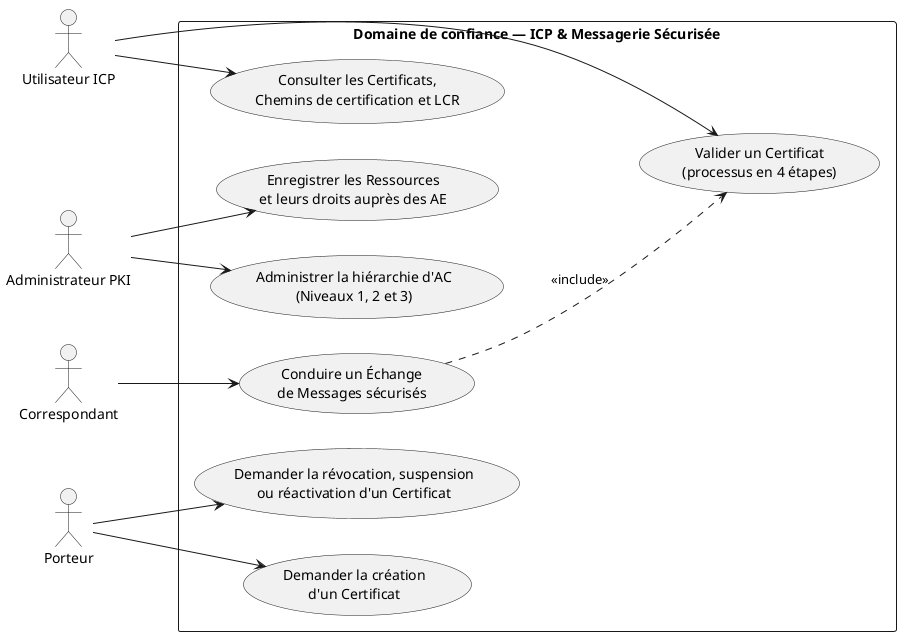
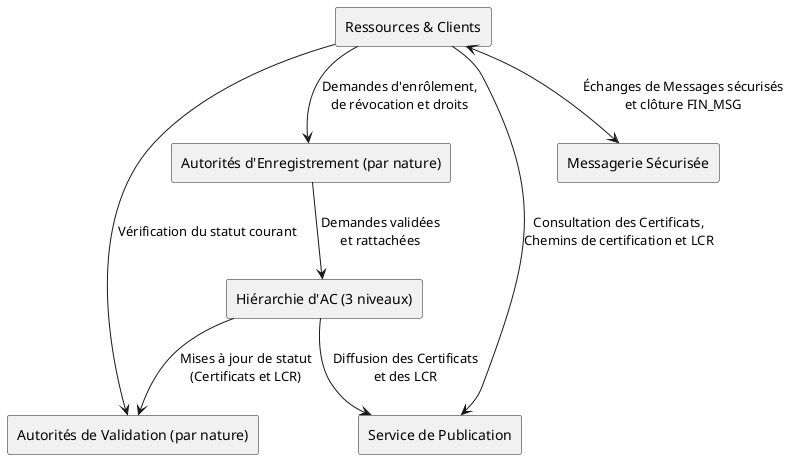
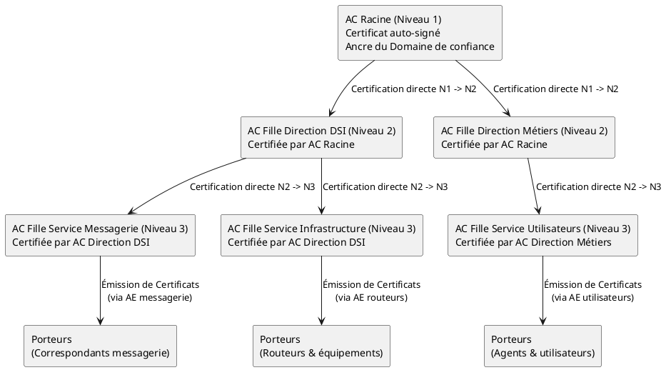
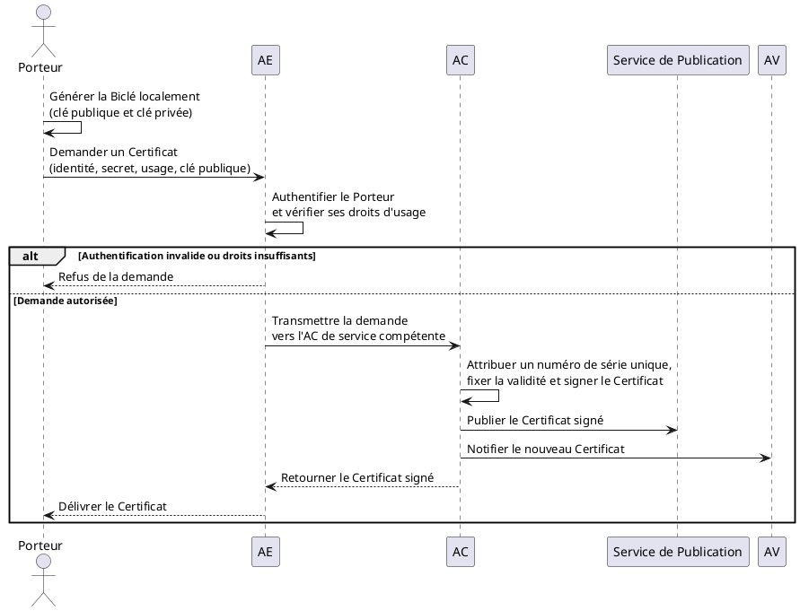
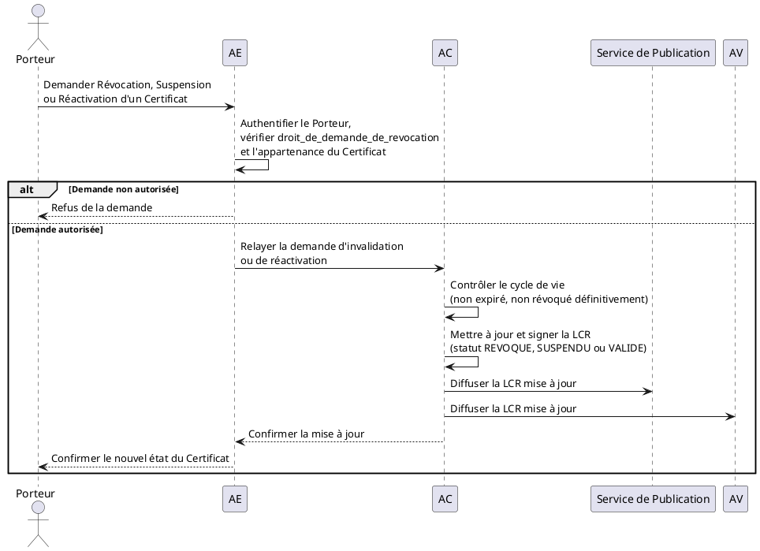
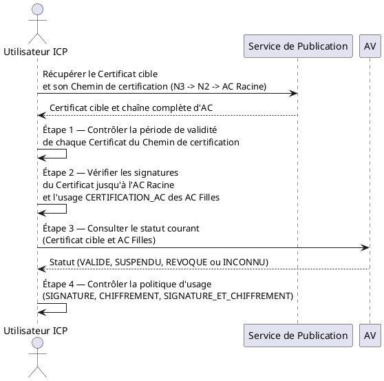
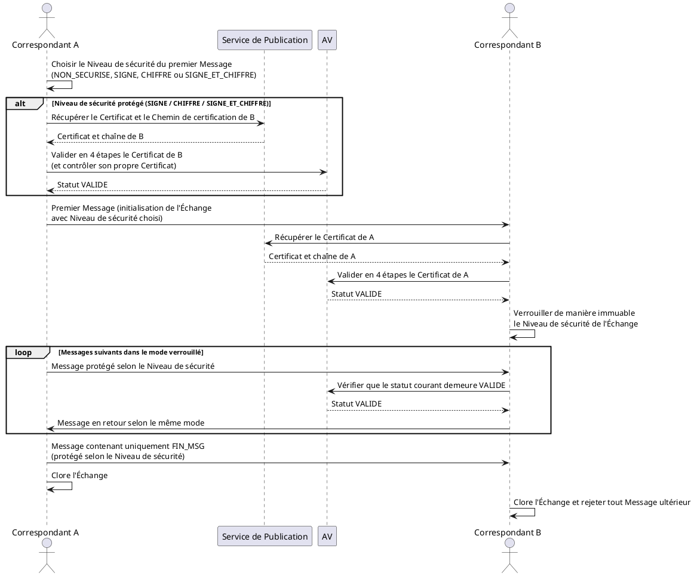
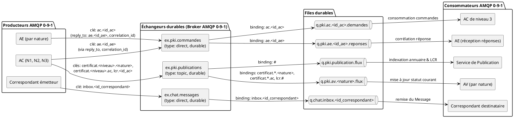
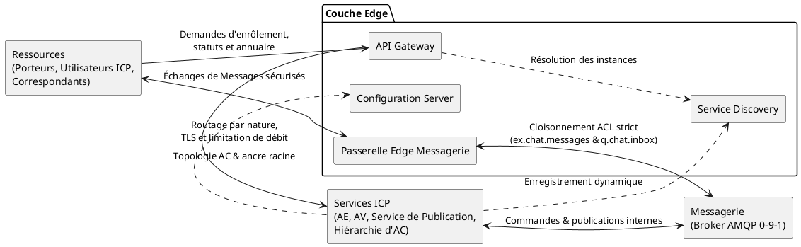

# Dossier de Conception — Infrastructure à Clés Publiques (ICP) & Messagerie Sécurisée

**Formation :** Master 2 STRI — Traitements Répartis (UPS / IRIT)  
**Documents de référence :**
- Cahier des charges 2026–2027 : [Projet_TR_STRI_2026_2027.pdf](../Projet_TR_STRI_2026_2027.pdf)
- Glossaire du domaine : [GLOSSARY.md](../GLOSSARY.md)
- Spécification OpenAPI 3.0.3 : [openapi/pki-api.yaml](../openapi/pki-api.yaml)
- Décisions d'architecture (ADR) :
  - [ADR 0001 — Répartition hybride REST et AMQP 0-9-1](./adr/0001-repartition-hybride-rest-amqp.md)
  - [ADR 0002 — Découplage entre les AE/AV par nature de ressource et la hiérarchie d'AC par organisation](./adr/0002-decouplage-ae-av-et-hierarchie-ac.md)

---

## Table des matières

1. [Contexte, Domaine de confiance et modèle du noyau](#1-contexte-domaine-de-confiance-et-modèle-du-noyau)
2. [Vue fonctionnelle](#2-vue-fonctionnelle)
3. [Entités logicielles réparties et architecture en blocs](#3-entités-logicielles-réparties-et-architecture-en-blocs)
4. [Interactions dynamiques](#4-interactions-dynamiques)
5. [Choix argumentés sur les technologies de répartition](#5-choix-argumentés-sur-les-technologies-de-répartition)
6. [Architecture AMQP 0-9-1 complète](#6-architecture-amqp-0-9-1-complète)
7. [Ressources REST, schéma de nommage et spécification OpenAPI 3.0.3](#7-ressources-rest-schéma-de-nommage-et-spécification-openapi-303)
8. [Micro-services « Edge »](#8-micro-services--edge-)

---

## 1. Contexte, Domaine de confiance et modèle du noyau

### 1.1 Objectifs et Domaine de confiance

L'application conçoit et met en œuvre une **Infrastructure à Clés Publiques (ICP)** hiérarchique simplifiée, déployée au sein d'un unique **Domaine de confiance** organisationnel, ainsi qu'une application de **Messagerie Sécurisée** texte de type « chat » entre les **Ressources** de cette organisation (humaines, matérielles telles que des routeurs, ou logicielles telles que des clients de messagerie).

Dans ce **Domaine de confiance**, gouverné par une même **AC Racine**, les identités des **Ressources** et les numéros de série des **Certificats** sont strictement uniques. Avant toute opération cryptographique (vérifier une signature ou chiffrer un contenu), un **Utilisateur ICP** doit répondre avec certitude à deux questions fondamentales :
1. **« À qui appartient cette clé publique ? »** — authenticité du lien entre le **Sujet** et la **Biclé**, garantie par la signature de l'**Autorité de Certification (AC)** émettrice et par le **Chemin de certification** remontant jusqu'à l'**AC Racine**.
2. **« À quoi sert cette clé publique ? »** — conformité de l'opération envisagée avec l'`usage` inscrit dans le **Certificat** et les droits attribués lors de l'enrôlement.

### 1.2 Modèle de données du noyau

Conformément au cahier des charges, le noyau repose sur trois structures de données canoniques : le **Certificat** (7 champs obligatoires du noyau complétés par des métadonnées d'identification), l'entrée d'enregistrement dans une **Autorité d'Enregistrement (AE)**, et l'entrée d'une **Liste des Certificats Révoqués (LCR)**.

| Structure | Attribut | Type / Valeurs | Rôle et invariants dans le Domaine de confiance |
| :--- | :--- | :--- | :--- |
| **Certificat** *(7 champs du noyau)* | `numeroSerie` | `string` | Numéro de série unique dans tout le **Domaine de confiance** (ex. `SN-2026-N3-DSI-MESSAGERIE-000006`). |
| | `identifiantAcEmettrice` | `string` | Identifiant de l'**AC** ayant émis et signé le **Certificat** (ex. `AC-N3-DSI-MESSAGERIE`). |
| | `dateDebutValidite` / `dateFinValidite` | ISO-8601 (`date-time`) | Période de validité (couple de deux dates bornant l'utilisation légitime). |
| | `usage` | `SIGNATURE` \| `CHIFFREMENT` \| `SIGNATURE_ET_CHIFFREMENT` \| `CERTIFICATION_AC` | Portée explicite autorisée pour la **Biclé** (`CERTIFICATION_AC` est exclusif aux **AC**). |
| | `sujet` | `string` | Identité attestée du **Porteur** ou de l'**AC** (ex. `alice.martin@dsi.organisation.fr`). |
| | `clePublique` | `string` (Base64) | Clé publique de la **Biclé** du **Sujet**. |
| | `signatureAc` | `string` | Signature numérique calculée par l'**AC** émettrice sur les champs précédents. |
| **Certificat** *(métadonnées)* | `niveauAcEmettrice` | `integer` (`1`, `2`, `3`) | Niveau hiérarchique de l'**AC** signataire (`1` = **AC Racine**, `2` = **AC Fille** Direction, `3` = **AC Fille** Service). |
| | `natureRessource` | `string` | Nature de **Ressource** (`messagerie`, `routeurs`, `services`, `utilisateurs`, ou `autorite_certification`). |
| | `algorithmeSignature` | `string` | Algorithme de signature employé par l'**AC** (`SHA256withRSA`). |
| **Entrée AE** | `nom_entité` (`nomEntite`) | `string` | Identifiant unique de la **Ressource** auprès de l'**AE** de sa nature. |
| | `mot_de_passe` (`motDePasse`) | `string` (haché salé) | Secret d'authentification vérifié par l'**AE** à chaque demande. |
| | `droit_signature` (`droitSignature`) | `boolean` | Autorise la **Ressource** à obtenir un **Certificat** de signature. |
| | `droit_chiffrement` (`droitChiffrement`) | `boolean` | Autorise la **Ressource** à obtenir un **Certificat** de chiffrement. |
| | `droit_de_demande_de_revocation` (`droitDemandeRevocation`) | `boolean` | Autorise le **Porteur** à demander la **Révocation**, la **Suspension** ou la **Réactivation** de son **Certificat**. |
| | `acRattachementId` | `string` | Identifiant de l'**AC Fille** de niveau 3 correspondant au service organisationnel de la **Ressource**. |
| **LCR & Entrée LCR** | `identifiantAc`, `numeroVersionLcr`, `dateEmission`, `prochaineMiseAJour`, `signatureAc` | Métadonnées LCR | Enveloppe signée par l'**AC** versionnant la **Liste des Certificats Révoqués (LCR)** à chaque mise à jour. |
| | `numeroSerieCertificat` | `string` | Numéro de série du **Certificat** invalidé avant sa date de fin de validité. |
| | `statut` | `REVOQUE` \| `SUSPENDU` | Nature de l'invalidation (`REVOQUE` définitif ; `SUSPENDU` temporaire). |
| | `dateInvalidation` | ISO-8601 (`date-time`) | Date et heure de prise d'effet de l'invalidation. |
| | `motif` | `COMPROMISSION_CLE_PRIVEE` \| `CESSATION_ACTIVITE` \| `CHANGEMENT_AFFILIATION` \| `SUSPENSION_TEMPORAIRE` \| `FIN_SUSPENSION` \| `AUTRE` | Raison normalisée de l'inscription dans la **LCR**. |

### 1.3 Machine d'états du cycle de vie d'un Certificat

Tout **Certificat** suit un cycle de vie strict contrôlé par l'**AC** émettrice et reflété par les **Autorités de Validation (AV)** :

```text
[INCONNU] ──(Émission & signature par l'AC)──▶ [VALIDE]
                                                │     ▲
                             (Suspension)       │     │ (Réactivation si non expiré)
                                                ▼     │
                                              [SUSPENDU]
                                                │
[VALIDE] ──(Révocation)─────────────────────────┼────▶ [REVOQUE] (état final irréversible)
                                                │          ▲
[SUSPENDU] ──(Révocation)───────────────────────┴──────────┘
```

Invariants appliqués par l'**AC** :
- Un **Certificat** passé en état `REVOQUE` ne peut jamais redevenir `VALIDE` ni `SUSPENDU` (toute demande de **Réactivation** est rejetée).
- Un **Certificat** déjà expiré (`maintenant > dateFinValidite`) ne peut plus subir une **Révocation**, une **Suspension** ni une **Réactivation**.
- La **Réactivation** retire le numéro de série de la **LCR** active de l'**AC** et incrémente son `numeroVersionLcr`.

---

## 2. Vue fonctionnelle

### 2.1 Acteurs et cas d'utilisation

Le système réparti implique quatre acteurs canoniques :
1. **Administrateur PKI** : initialise la hiérarchie d'**AC** sur trois niveaux et enregistre les **Ressources** ainsi que leurs droits booléens auprès des **AE**.
2. **Porteur** : **Ressource** détenant sa clé privée ; sollicite la création, la **Révocation**, la **Suspension** ou la **Réactivation** de son **Certificat** auprès de l'**AE** de sa nature.
3. **Utilisateur ICP** : consulte le **Service de Publication** (Certificats, **Chemins de certification**, **LCR**) et exécute la validation d'un **Certificat** en 4 étapes en s'appuyant sur l'**AV** de la nature concernée.
4. **Correspondant** : **Ressource** participant à un **Échange** de messagerie texte sécurisée, cumulant les rôles de **Porteur** (signer ses **Messages** sortants, déchiffrer les **Messages** reçus) et d'**Utilisateur ICP** (valider en 4 étapes le **Certificat** de l'autre **Correspondant** avant l'**Échange** et contrôler son statut pendant la session).

### 2.2 Diagramme de cas d'utilisation UML

Source autonome : [01-cas-utilisation.puml](./diagrams/01-cas-utilisation.puml)



---

## 3. Entités logicielles réparties et architecture en blocs

### 3.1 Rôle des entités logicielles réparties

Conformément à l'[ADR 0002](./adr/0002-decouplage-ae-av-et-hierarchie-ac.md), l'architecture découple les deux axes imposés par le sujet : les **AE** et **AV** sont mutualisées par *nature de **Ressource*** (`messagerie`, `routeurs`, `services`, `utilisateurs`), tandis que la hiérarchie d'**AC** épouse l'organigramme de l'organisation sur trois niveaux. Cette vue reste strictement indépendante des choix de transport.

| Bloc métier | Cardinalité | Responsabilités dans le Domaine de confiance |
| :--- | :--- | :--- |
| **Ressources & Clients** | Multiple (humains, routeurs, logiciels) | Agissent comme **Porteurs** (détention de la clé privée, demande de **Certificat** et d'invalidation), **Utilisateurs ICP** (validation en 4 étapes) et **Correspondants** (chiffrement/signature des **Messages**). |
| **Autorités d'Enregistrement (par nature)** | 1 par nature de **Ressource** | Authentifient les demandeurs (`nom_entité`, `mot_de_passe`), vérifient leurs droits (`droit_signature`, `droit_chiffrement`, `droit_de_demande_de_revocation`) ainsi que l'appartenance du **Certificat** lors d'une invalidation, puis acheminent la demande vers l'**AC Fille** de niveau 3 compétente. |
| **Autorités de Validation (par nature)** | 1 par nature de **Ressource** | Maintiennent à jour l'état courant des **Certificats** de leur nature et des **AC** de la hiérarchie à partir des diffusions des **AC**, afin de fournir immédiatement le statut (`VALIDE`, `SUSPENDU`, `REVOQUE`, `INCONNU`) aux **Utilisateurs ICP**. |
| **Service de Publication** | Référentiel partagé unique | Collecte et rend consultables tous les **Certificats** émis (dont les **Chemins de certification** complets) et toutes les **LCR** signées publiées par les **AC**. |
| **Hiérarchie d'AC (3 niveaux)** | 1 **AC Racine** (N1) + **AC Filles** Direction (N2) + **AC Filles** Service (N3) | L'**AC Racine** auto-signée certifie les **AC Filles** de niveau 2, qui certifient les **AC Filles** de niveau 3. Les **AC** de niveau 3 émettent les **Certificats** des **Porteurs**, génèrent optionnellement une **Biclé** à la demande, maintiennent leur **LCR** signée et diffusent chaque émission ou invalidation. |
| **Messagerie Sécurisée** | Service logique de remise de **Messages** | Acheminent les **Messages** entre deux **Correspondants** selon le **Niveau de sécurité** verrouillé lors du premier **Message** jusqu'à la clôture explicite par `FIN_MSG`. |

### 3.2 Architecture globale en 6 blocs

Source autonome : [02-architecture-blocs.puml](./diagrams/02-architecture-blocs.puml)



### 3.3 Hiérarchie d'AC sur 3 niveaux

La certification des **AC Filles** (niveau 1 $\rightarrow$ niveau 2 et niveau 2 $\rightarrow$ niveau 3) relève d'une administration interne directe entre **AC** parente et **AC Fille** ; les **AE** interviennent exclusivement pour les **Porteurs** finaux.

Source autonome : [03-hierarchie-ac.puml](./diagrams/03-hierarchie-ac.puml)



---

## 4. Interactions dynamiques

Les quatre diagrammes de séquence ci-dessous décrivent les interactions métier des quatre processus du cahier des charges, sans dépendance technologique.

### 4.1 Processus de création de Certificat

Dans le flux nominal, le **Porteur** génère sa **Biclé** localement, conserve sa clé privée secrète et ne soumet que sa clé publique à l'**AE** de sa nature. En variante optionnelle (par exemple pour un routeur contraint), le **Porteur** peut déléguer la création de la **Biclé** à l'**AC**, qui retourne la clé privée générée une unique fois sans la conserver ni côté **AC** ni côté **AE**.

Source autonome : [04-sequence-creation-certificat.puml](./diagrams/04-sequence-creation-certificat.puml)



### 4.2 Processus de Révocation, Suspension et Réactivation

Avant la date de fin de validité d'un **Certificat**, son **Porteur** peut demander auprès de l'**AE** sa **Révocation** (irréversible), sa **Suspension** (réversible) ou sa **Réactivation** (levée d'une **Suspension**). L'**AE** contrôle l'authentification, le droit `droit_de_demande_de_revocation` et la correspondance entre le demandeur et le **Sujet** du **Certificat** ; l'**AC** vérifie les invariants du cycle de vie puis publie immédiatement sa **LCR** signée.

Source autonome : [05-sequence-revocation-suspension.puml](./diagrams/05-sequence-revocation-suspension.puml)



### 4.3 Processus de validation en 4 étapes

L'**Utilisateur ICP** orchestre lui-même les 4 étapes obligatoires de validation à partir de l'ancre de confiance de l'**AC Racine**, des preuves récupérées auprès du **Service de Publication**, et du statut courant interrogé auprès de l'**AV** (sur le **Certificat** cible ainsi que sur chaque **AC Fille** intermédiaire du **Chemin de certification**).

Source autonome : [06-sequence-validation-4-etapes.puml](./diagrams/06-sequence-validation-4-etapes.puml)



### 4.4 Processus de Messagerie Sécurisée (« chat » et `FIN_MSG`)

Lors de l'initialisation d'un **Échange**, le **Correspondant** initiateur choisit le **Niveau de sécurité** (`NON_SECURISE`, `SIGNE`, `CHIFFRE` ou `SIGNE_ET_CHIFFRE`). Hors mode `NON_SECURISE`, chacun des deux **Correspondants** valide en 4 étapes le **Certificat** de son partenaire et vérifie le sien. Le **Niveau de sécurité** est verrouillé de manière immuable dès le premier **Message** et chaque envoi ultérieur contrôle l'absence de révocation/suspension jusqu'à réception d'un **Message** contenant uniquement `FIN_MSG`.

Source autonome : [07-sequence-messagerie-securisee.puml](./diagrams/07-sequence-messagerie-securisee.puml)



---

## 5. Choix argumentés sur les technologies de répartition

Conformément à l'[ADR 0001](./adr/0001-repartition-hybride-rest-amqp.md), l'architecture combine **REST (HTTP/JSON documenté en OpenAPI 3.0.3)** pour les façades externes synchrones et **AMQP 0-9-1** pour les flux internes asynchrones, la diffusion événementielle et la messagerie texte.

| Segment d'interaction | Technologie retenue | Modèle d'échange | Argumentaire et compromis étudiés |
| :--- | :--- | :--- | :--- |
| **Porteur $\leftrightarrow$ AE** *(création, suivi, invalidation, droits)* | **REST (HTTP/JSON)** | Requête / Réponse synchrone (`201`/`202`) | Les **Porteurs** sont hétérogènes (clients logiciels, routeurs matériels, scripts). HTTP/JSON est universel et évite d'embarquer un client AMQP sur chaque matériel. Les codes HTTP (`401`, `403`, `404`, `409`) modélisent directement l'authentification et les rejets de cycle de vie. |
| **Utilisateur ICP $\leftrightarrow$ AV** *(statut courant)* | **REST (HTTP/JSON)** | Requête / Réponse synchrone (`GET`) | L'étape 3 de validation exige une réponse synchrone immédiate avant signature ou chiffrement. Une opération `GET` sans état est idempotente et répartissable derrière l'`API Gateway`. |
| **Utilisateur ICP $\leftrightarrow$ Service de Publication** *(annuaire, chemins, LCR)* | **REST (HTTP/JSON)** | Requête / Réponse synchrone (`GET`) | La recherche multicritère (`?sujet=...`, `?usage=...`), l'accès par numéro de série et la résolution du **Chemin de certification** relèvent naturellement d'un annuaire REST cacheable. |
| **AE $\leftrightarrow$ AC de niveau 3** *(commandes et réponses)* | **AMQP 0-9-1** (`direct`, durable) | Point-à-point asynchrone avec corrélation (`correlation_id`, `reply_to`) | *Compromis écarté* : exposer les **AC** en REST augmenterait leur surface d'attaque et imposerait une disponibilité synchrone permanente. Avec `ex.pki.commandes`, les **AC** n'ouvrent aucun port HTTP entrant et absorbent les pics d'enrôlement grâce aux files durables `q.pki.ac.<id_ac>.demandes`. |
| **AC (N1, N2, N3) $\rightarrow$ Service de Publication & AV** *(Certificats & LCR)* | **AMQP 0-9-1** (`topic`, durable) | Publication / Abonnement 1-vers-$N$ | *Compromis écarté* : une interrogation périodique (*polling*) par les **AV** introduirait une fenêtre de latence critique après une **Révocation**. L'échangeur `topic` `ex.pki.publications` pousse instantanément chaque **Certificat** et chaque **LCR** vers le **Service de Publication** et les **AV** filtrant uniquement leur nature et les **AC**. |
| **Correspondant A $\leftrightarrow$ Correspondant B** *(Messagerie Sécurisée)* | **AMQP 0-9-1** (`direct`, durable) | Point-à-point asynchrone ordonné | *Compromis écarté* : un modèle purement REST imposerait un serveur HTTP sur chaque poste client ou du *polling* continu. AMQP `ex.chat.messages` vers `q.chat.inbox.<id_correspondant>` garantit la mise en file durable lors des déconnexions passagères et l'ordre de remise jusqu'à `FIN_MSG`. |

---

## 6. Architecture AMQP 0-9-1 complète

### 6.1 Vue topologique AMQP 0-9-1

Source autonome : [08-architecture-amqp.puml](./diagrams/08-architecture-amqp.puml)



### 6.2 Inventaire des 3 échangeurs durables

| Échangeur | Type AMQP | Durabilité | Producteurs | Rôle |
| :--- | :--- | :--- | :--- | :--- |
| `ex.pki.commandes` | `direct` | Durable | **AE** (commandes) et **AC** niveau 3 (réponses) | Acheminement point-à-point des commandes de certification/révocation vers l'**AC** cible et retour corrélé vers l'**AE** demandeuse. |
| `ex.pki.publications` | `topic` | Durable | Toutes les **AC** (niveaux 1, 2 et 3) | Diffusion temps réel 1-vers-$N$ des nouveaux **Certificats** et des **LCR** signées avec filtrage par clé hiérarchique. |
| `ex.chat.messages` | `direct` | Durable | **Correspondants** (via la **Passerelle Edge Messagerie**) | Transport asynchrone des **Messages** texte sécurisés entre les boîtes de réception des **Correspondants**. |

### 6.3 Inventaire des 5 files durables et bindings

| File durable | Échangeur source | Clé(s) de binding | Clé(s) de routage publiées | Consommateur |
| :--- | :--- | :--- | :--- | :--- |
| `q.pki.ac.<id_ac>.demandes` | `ex.pki.commandes` (`direct`) | `ac.<id_ac>` | `ac.<id_ac>` | Instance d'**AC Fille** de niveau 3 `<id_ac>` (ex. `AC-N3-DSI-MESSAGERIE`). |
| `q.pki.ae.<id_ae>.reponses` | `ex.pki.commandes` (`direct`) | `ae.<id_ae>` | `ae.<id_ae>` (via `reply_to`) | Instance d'**AE** `<id_ae>` (ex. `ae-messagerie`). |
| `q.pki.publication.flux` | `ex.pki.publications` (`topic`) | `#` | `certificat.n<niveau>.<nature>`, `certificat.n<niveau>.ac`, `lcr.<id_ac>` | **Service de Publication** (reçoit la totalité des **Certificats** et **LCR** du **Domaine de confiance**). |
| `q.pki.av.<nature>.flux` | `ex.pki.publications` (`topic`) | `certificat.*.<nature>`, `certificat.*.ac`, `lcr.#` | Idem (`ex.pki.publications`) | **AV** de la nature `<nature>` (ex. `av-messagerie`) : reçoit uniquement les **Certificats** de sa nature, ceux des **AC**, et toutes les **LCR**. |
| `q.chat.inbox.<id_correspondant>` | `ex.chat.messages` (`direct`) | `inbox.<id_correspondant>` | `inbox.<id_correspondant>` | Client du **Correspondant** `<id_correspondant>` (via l'ACL stricte de la **Passerelle Edge Messagerie**). |

### 6.4 Propriétés AMQP 0-9-1 standards

Tous les messages transportés par le courtier AMQP 0-9-1 portent une charge utile JSON encodée en UTF-8 et les propriétés standard suivantes :
- `content_type` : `"application/json"`
- `delivery_mode` : `2` (persistant)
- `message_id` : identifiant UUID unique du message AMQP
- `type` : nom canonique du type de message parmi les 9 types spécifiés ci-dessous
- `correlation_id` : UUID `demandeId` sur `ex.pki.commandes`, ou `echangeId` sur `ex.chat.messages`
- `reply_to` : clé de routage de retour `ae.<id_ae>` (obligatoire pour les commandes `DEMANDE_CERTIFICATION` et `DEMANDE_REVOCATION`)
- `timestamp` : horodatage ISO-8601 UTC
- `headers` : table associative applicative (`aeId`, `natureRessource`, `acId`, `niveau`, `numeroVersionLcr`, et pour le chat `echange_id`, `type_message`, `niveau_securite`, `emetteur_id`, `destinataire_id`, `numero_sequence`).

### 6.5 Spécification détaillée des 9 types de messages JSON

#### 1. `DEMANDE_CERTIFICATION`
- **Échangeur / Clé de routage** : `ex.pki.commandes` / `ac.<id_ac>` $\rightarrow$ `q.pki.ac.<id_ac>.demandes`
- **Propriétés AMQP** : `type: "DEMANDE_CERTIFICATION"`, `correlation_id: "<demandeId>"`, `reply_to: "ae.<id_ae>"`, `headers: { aeId, natureRessource }`
- **Charge utile JSON** (`CommandeDemandeCertificationPayload`) : `demandeId`, `sujet`, `natureRessource`, `acCibleId`, `usage`, `clePublique` (optionnel si `genererBicle: true`), `genererBicle` (`boolean`), `dureeValiditeJours` (optionnel).

```json
{
  "demandeId": "6b1f8c20-9a4e-4d1c-8e33-0192837465ab",
  "sujet": "alice.martin@dsi.organisation.fr",
  "natureRessource": "messagerie",
  "acCibleId": "AC-N3-DSI-MESSAGERIE",
  "usage": "SIGNATURE_ET_CHIFFREMENT",
  "clePublique": "MIIBIjANBgkqhkiG9w0BAQEFAAOCAQ8AMIIBCgKCAQEAu7x9k2...",
  "genererBicle": false
}
```

#### 2. `REPONSE_CERTIFICATION`
- **Échangeur / Clé de routage** : `ex.pki.commandes` / `ae.<id_ae>` (reprise de `reply_to`) $\rightarrow$ `q.pki.ae.<id_ae>.reponses`
- **Propriétés AMQP** : `type: "REPONSE_CERTIFICATION"`, `correlation_id: "<demandeId>"`, `headers: { acId }`
- **Charge utile JSON** (`ReponseDemandeCertificationPayload`) : `demandeId`, `statut` (`"EMISE"` | `"REJETEE"`), `certificat` (si `"EMISE"`), `clePriveeGeneree` (`string | null`, renseignée une seule fois si `genererBicle: true`), `erreur` (si `"REJETEE"` : `{ code, message }`).

```json
{
  "demandeId": "6b1f8c20-9a4e-4d1c-8e33-0192837465ab",
  "statut": "EMISE",
  "certificat": {
    "numeroSerie": "SN-2026-N3-DSI-MESSAGERIE-000006",
    "identifiantAcEmettrice": "AC-N3-DSI-MESSAGERIE",
    "niveauAcEmettrice": 3,
    "dateDebutValidite": "2026-11-26T09:00:00.000Z",
    "dateFinValidite": "2027-11-26T09:00:00.000Z",
    "usage": "SIGNATURE_ET_CHIFFREMENT",
    "sujet": "alice.martin@dsi.organisation.fr",
    "natureRessource": "messagerie",
    "clePublique": "MIIBIjANBgkqhkiG9w0BAQEFAAOCAQ8AMIIBCgKCAQEAu7x9k2...",
    "algorithmeSignature": "SHA256withRSA",
    "signatureAc": "f8a9c12e4b701d9e3a..."
  },
  "clePriveeGeneree": null
}
```

#### 3. `DEMANDE_REVOCATION`
- **Échangeur / Clé de routage** : `ex.pki.commandes` / `ac.<id_ac>` $\rightarrow$ `q.pki.ac.<id_ac>.demandes`
- **Propriétés AMQP** : `type: "DEMANDE_REVOCATION"`, `correlation_id: "<demandeId>"`, `reply_to: "ae.<id_ae>"`, `headers: { aeId, natureRessource }`
- **Charge utile JSON** (`CommandeDemandeRevocationPayload`) : `demandeId`, `sujet`, `numeroSerieCertificat`, `acCibleId`, `action` (`"REVOCATION"` | `"SUSPENSION"` | `"REACTIVATION"`), `motif` (optionnel).

```json
{
  "demandeId": "f47ac10b-58cc-4372-a567-0e02b2c3d479",
  "sujet": "alice.martin@dsi.organisation.fr",
  "numeroSerieCertificat": "SN-2026-N3-DSI-MESSAGERIE-000006",
  "acCibleId": "AC-N3-DSI-MESSAGERIE",
  "action": "REVOCATION",
  "motif": "COMPROMISSION_CLE_PRIVEE"
}
```

#### 4. `REPONSE_REVOCATION`
- **Échangeur / Clé de routage** : `ex.pki.commandes` / `ae.<id_ae>` $\rightarrow$ `q.pki.ae.<id_ae>.reponses`
- **Propriétés AMQP** : `type: "REPONSE_REVOCATION"`, `correlation_id: "<demandeId>"`, `headers: { acId }`
- **Charge utile JSON** (`ReponseDemandeRevocationPayload`) : `demandeId`, `numeroSerieCertificat`, `identifiantAc`, `statut` (`"APPLIQUEE"` | `"REJETEE"`), `actionAppliquee`, `nouvelEtatCertificat`, `horodatagePublicationLcr`, `erreur` (optionnel si `"REJETEE"` : `{ httpStatus, code, message }`).

```json
{
  "demandeId": "f47ac10b-58cc-4372-a567-0e02b2c3d479",
  "numeroSerieCertificat": "SN-2026-N3-DSI-MESSAGERIE-000006",
  "identifiantAc": "AC-N3-DSI-MESSAGERIE",
  "statut": "APPLIQUEE",
  "actionAppliquee": "REVOCATION",
  "nouvelEtatCertificat": "REVOQUE",
  "horodatagePublicationLcr": "2026-11-26T09:05:12.000Z"
}
```

#### 5. `PUBLICATION_CERTIFICAT`
- **Échangeur / Clé de routage** : `ex.pki.publications` / `certificat.n<niveau>.<nature>` (pour un **Porteur**) ou `certificat.n<niveau>.ac` (pour une **AC**) $\rightarrow$ `q.pki.publication.flux` et `q.pki.av.<nature>.flux`
- **Propriétés AMQP** : `type: "PUBLICATION_CERTIFICAT"`, `headers: { acId, niveau }`
- **Charge utile JSON** (`PublicationCertificatPayload`) : `certificat` (complet) et `autoriteInfo` (optionnel, présent lors de la publication d'une **AC** : `{ acId, nomOrganisationnel, niveau, acParenteId, certificatAc }`).

```json
{
  "certificat": {
    "numeroSerie": "SN-2026-N3-DSI-MESSAGERIE-000006",
    "identifiantAcEmettrice": "AC-N3-DSI-MESSAGERIE",
    "niveauAcEmettrice": 3,
    "dateDebutValidite": "2026-11-26T09:00:00.000Z",
    "dateFinValidite": "2027-11-26T09:00:00.000Z",
    "usage": "SIGNATURE_ET_CHIFFREMENT",
    "sujet": "alice.martin@dsi.organisation.fr",
    "natureRessource": "messagerie",
    "clePublique": "MIIBIjANBgkqhkiG9w0BAQEFAAOCAQ8AMIIBCgKCAQEAu7x9k2...",
    "algorithmeSignature": "SHA256withRSA",
    "signatureAc": "f8a9c12e4b701d9e3a..."
  }
}
```

#### 6. `PUBLICATION_LCR`
- **Échangeur / Clé de routage** : `ex.pki.publications` / `lcr.<id_ac>` $\rightarrow$ `q.pki.publication.flux` et toutes les files `q.pki.av.<nature>.flux`
- **Propriétés AMQP** : `type: "PUBLICATION_LCR"`, `headers: { acId, niveau, numeroVersionLcr }`
- **Charge utile JSON** (`PublicationLcrPayload`) : champ `lcr` (`ListeCertificatsRevoques` signée par l'**AC**).

```json
{
  "lcr": {
    "identifiantAc": "AC-N3-DSI-MESSAGERIE",
    "numeroVersionLcr": 2,
    "dateEmission": "2026-11-26T09:05:12.000Z",
    "prochaineMiseAJour": "2026-11-27T09:05:12.000Z",
    "entrees": [
      {
        "numeroSerieCertificat": "SN-2026-N3-DSI-MESSAGERIE-000006",
        "statut": "REVOQUE",
        "dateInvalidation": "2026-11-26T09:05:12.000Z",
        "motif": "COMPROMISSION_CLE_PRIVEE"
      }
    ],
    "signatureAc": "7b3e91a04d2c8f..."
  }
}
```

#### 7. `INIT_ECHANGE`
- **Échangeur / Clé de routage** : `ex.chat.messages` / `inbox.<id_correspondant>` $\rightarrow$ `q.chat.inbox.<id_correspondant>`
- **Propriétés AMQP** : `type: "INIT_ECHANGE"`, `correlation_id: "<echangeId>"`, `headers: { echange_id, type_message: "INIT_ECHANGE", niveau_securite, emetteur_id, destinataire_id, numero_sequence: 1 }`
- **Charge utile JSON** (`MessageChatPayload`) : ouvre l'**Échange** avec `numeroSequence: 1` et verrouille le `niveauSecurite` (`NON_SECURISE`, `SIGNE`, `CHIFFRE`, `SIGNE_ET_CHIFFRE`). Selon le mode :
  - `NON_SECURISE` : `contenu` en clair uniquement ;
  - `SIGNE` : `contenu`, `signature` (RSA-SHA256 sur le JSON canonique du message) et `numeroSerieCertificatSignature` ;
  - `CHIFFRE` : `contenuChiffre` (chiffrement hybride RSA-OAEP + AES-256-GCM) et `numeroSerieCertificatChiffrement` ;
  - `SIGNE_ET_CHIFFRE` : `contenuChiffre` (renfermant le JSON `{ contenu, signature, numeroSerieCertificatSignature }`) et `numeroSerieCertificatChiffrement`.

```json
{
  "echangeId": "c3f1a904-1e2d-4c87-9f22-112233445566",
  "numeroSequence": 1,
  "typeMessage": "INIT_ECHANGE",
  "niveauSecurite": "SIGNE_ET_CHIFFRE",
  "emetteurId": "alice.martin@dsi.organisation.fr",
  "destinataireId": "bob.dupont@dsi.organisation.fr",
  "horodatage": "2026-11-26T09:15:00.000Z",
  "contenuChiffre": "{\"alg\":\"RSA-OAEP+AES-256-GCM\",\"iv\":\"...\",\"tag\":\"...\",\"key\":\"...\",\"data\":\"...\"}",
  "numeroSerieCertificatChiffrement": "SN-2026-N3-DSI-MESSAGERIE-000007"
}
```

#### 8. `MSG_TEXTE`
- **Échangeur / Clé de routage** : `ex.chat.messages` / `inbox.<id_correspondant>` $\rightarrow$ `q.chat.inbox.<id_correspondant>`
- **Propriétés AMQP** : `type: "MSG_TEXTE"`, `correlation_id: "<echangeId>"`, `headers: { echange_id, type_message: "MSG_TEXTE", niveau_securite, emetteur_id, destinataire_id, numero_sequence }`
- **Charge utile JSON** (`MessageChatPayload`) : transporte un **Message** applicatif au sein d'un **Échange** actif avec un `numeroSequence` strictement croissant par émetteur et le même `niveauSecurite` verrouillé (exemple ci-dessous en mode `SIGNE`).

```json
{
  "echangeId": "c3f1a904-1e2d-4c87-9f22-112233445566",
  "numeroSequence": 2,
  "typeMessage": "MSG_TEXTE",
  "niveauSecurite": "SIGNE",
  "emetteurId": "bob.dupont@dsi.organisation.fr",
  "destinataireId": "alice.martin@dsi.organisation.fr",
  "horodatage": "2026-11-26T09:15:30.000Z",
  "contenu": "Bien reçu Alice, les paramètres sont validés.",
  "signature": "a49c0e8b12f3...",
  "numeroSerieCertificatSignature": "SN-2026-N3-DSI-MESSAGERIE-000007"
}
```

#### 9. `FIN_MSG`
- **Échangeur / Clé de routage** : `ex.chat.messages` / `inbox.<id_correspondant>` $\rightarrow$ `q.chat.inbox.<id_correspondant>`
- **Propriétés AMQP** : `type: "FIN_MSG"`, `correlation_id: "<echangeId>"`, `headers: { echange_id, type_message: "FIN_MSG", niveau_securite, emetteur_id, destinataire_id, numero_sequence }`
- **Charge utile JSON** (`MessageChatPayload`) : clôture définitivement l'**Échange** ; le texte en clair transporté (en clair ou chiffré selon le `niveauSecurite` verrouillé) vaut exclusivement `"FIN_MSG"`. Tout **Message** ultérieur sur cet `echangeId` est rejeté par les deux **Correspondants**.

```json
{
  "echangeId": "c3f1a904-1e2d-4c87-9f22-112233445566",
  "numeroSequence": 3,
  "typeMessage": "FIN_MSG",
  "niveauSecurite": "SIGNE_ET_CHIFFRE",
  "emetteurId": "alice.martin@dsi.organisation.fr",
  "destinataireId": "bob.dupont@dsi.organisation.fr",
  "horodatage": "2026-11-26T09:16:00.000Z",
  "contenuChiffre": "{\"alg\":\"RSA-OAEP+AES-256-GCM\",\"iv\":\"...\",\"tag\":\"...\",\"key\":\"...\",\"data\":\"...\"}",
  "numeroSerieCertificatChiffrement": "SN-2026-N3-DSI-MESSAGERIE-000007"
}
```

---

## 7. Ressources REST, schéma de nommage et spécification OpenAPI 3.0.3

### 7.1 Schéma de nommage et contrat OpenAPI 3.0.3

Toutes les façades REST sont exposées derrière l'`API Gateway` sous le préfixe commun `/api/v1`, avec des noms de ressources au pluriel en minuscules et des réponses d'erreur normalisées (`ErreurApi` : `code`, `message`, `horodatage`, `chemin`).

Le contrat formel est décrit dans [openapi/pki-api.yaml](../openapi/pki-api.yaml) (11 opérations réparties sur 3 familles) :

| Service | Méthode & Chemin (sous `/api/v1`) | Statuts HTTP | Rôle et contrat |
| :--- | :--- | :--- | :--- |
| **AE** *(par `{nature}`)* | `POST /ae/{nature}/demandes-certification` | `201`, `202` (`Location`), `400`, `401`, `403`, `404` | Authentifie le **Porteur** (`nomEntite`, `motDePasse`), contrôle ses droits (`droitSignature`, `droitChiffrement`) et publie `DEMANDE_CERTIFICATION` sur `ex.pki.commandes`. Supporte la clé publique fournie ou `genererBicle: true`. |
| | `GET /ae/{nature}/demandes-certification/{demandeId}` | `200`, `404` | Consulte l'état (`EN_ATTENTE_AC`, `EMISE`, `REJETEE`) et récupère le **Certificat** signé. |
| | `POST /ae/{nature}/demandes-revocation` | `200`, `400`, `401`, `403`, `404`, `409` | Authentifie le **Porteur**, vérifie `droitDemandeRevocation` et la possession du **Certificat**, puis relaie `REVOCATION`, `SUSPENSION` ou `REACTIVATION` vers l'**AC** (`409` si transition illégale ou **Certificat** expiré). |
| | `GET /ae/{nature}/entites/{nomEntite}/droits` | `200`, `401`, `404` | Retourne les droits enregistrés (`DroitsEntiteAE`) après authentification `BasicAuth`. |
| **AV** *(par `{nature}`)* | `GET /av/{nature}/certificats/{numeroSerie}/statut` | `200`, `400`, `404` | Retourne `StatutCertificatReponse` (`numeroSerie`, `statut` $\in$ `{VALIDE, SUSPENDU, REVOQUE, INCONNU}`, `identifiantAcEmettrice`, `motifInvalidation`, `dateInvalidation`, `horodatageVerification`, `identifiantAv`). |
| **Service de Publication** | `GET /annuaire/certificats` | `200` | Recherche multicritère (`sujet`, `acEmettriceId`, `usage`, `uniquementValides`). |
| | `GET /annuaire/certificats/{numeroSerie}` | `200`, `404` | Récupère un **Certificat** par numéro de série unique. |
| | `GET /annuaire/certificats/{numeroSerie}/chemin-certification` | `200`, `404` | Retourne le **Chemin de certification** ordonné `[Porteur, AC N3, AC N2, AC Racine N1]`. |
| | `GET /annuaire/autorites` | `200` | Liste la hiérarchie d'**AC** (filtre optionnel `niveau`). |
| | `GET /annuaire/autorites/{acId}/lcr` | `200`, `404` | Retourne la **LCR** signée publiée par l'**AC** `<acId>`. |
| | `GET /annuaire/lcr` | `200` | Retourne la liste consolidée des **LCR** du **Domaine de confiance**. |

### 7.2 Focalisation stricte de l'AV sur le statut courant

Conformément au cahier des charges, l'**Autorité de Validation (AV)** ne propose aucun endpoint de validation complète tout-en-un (`/validations` est volontairement absent). Elle se limite strictement à fournir le statut courant (`GET /av/{nature}/certificats/{numeroSerie}/statut`), laissant à l'**Utilisateur ICP** la pleine responsabilité d'orchestrer les 4 étapes de validation (période de validité, signatures et **Chemin de certification** jusqu'à l'**AC Racine**, statut auprès de l'**AV** sur la feuille et les **AC Filles**, et politique d'`usage`).

En complément des 11 routes métier décrites dans [openapi/pki-api.yaml](../openapi/pki-api.yaml), l'`API Gateway` expose les routes d'amorçage interne du **Configuration Server** (`/api/v1/config/topologie-ac`, `/api/v1/config/ancre-racine`, `/api/v1/config/amqp`).

---

## 8. Micro-services « Edge »

### 8.1 Architecture de la couche Edge

La couche Edge isole les services internes de l'ICP et le courtier AMQP 0-9-1 vis-à-vis des **Ressources** externes au travers de quatre micro-services complémentaires, représentés sans dépendance à un outil vendeur.

Source autonome : [09-microservices-edge.puml](./diagrams/09-microservices-edge.puml)



### 8.2 Justification des 4 rôles Edge

| Micro-service Edge | Rôle architectural | Valeur ajoutée pour l'ICP et la Messagerie Sécurisée |
| :--- | :--- | :--- |
| **API Gateway** | Point d'entrée REST unique (`/api/v1`) pour toutes les requêtes vers les **AE**, les **AV**, le **Service de Publication** et la configuration. | Impose le chiffrement de transport (`TLS` / `HTTPS`, rejet `403 TLS_REQUIS`), route les appels par `{nature}`, protège les **AE** contre les rafales par limitation de débit (`429 TROP_DE_REQUETES` avec `Retry-After`) et met en cache les données immuables (`X-Cache: MISS\|HIT` sur l'ancre racine et les **Chemins de certification**). |
| **Passerelle Edge Messagerie** | Médiateur d'accès AMQP 0-9-1 dédié exclusivement aux **Correspondants** externes. | Applique un **cloisonnement ACL/vhost strict** : un **Correspondant** `<id>` ne peut publier que sur `ex.chat.messages` (clé `inbox.<cible>`) avec des en-têtes chat valides et sans usurpation de `emetteur_id`, et ne peut consommer que sa propre file `q.chat.inbox.<id>`. Tout accès à `ex.pki.*`, `q.pki.*` ou à la file d'un tiers est bloqué (`ErreurAclEdge`). |
| **Service Discovery** | Registre dynamique des instances d'**AE**, d'**AV** (par nature de **Ressource**) et du **Service de Publication**. | Permet d'ajouter à chaud une nouvelle nature de **Ressource** (ex. `iot`) ou de répartir la charge sur plusieurs instances sans reconfigurer ni redémarrer l'`API Gateway`. |
| **Configuration Server** | Référentiel centralisé distribuant la topologie des **AC** sur 3 niveaux (`/config/topologie-ac`), le **Certificat** auto-signé de l'**AC Racine** (`/config/ancre-racine`) et les paramètres AMQP (`/config/amqp`). | Garantit que tous les **Utilisateurs ICP** partagent exactement la même ancre de confiance racine et que les **AE** disposent d'une vue cohérente de la hiérarchie organisationnelle des **AC**. |
